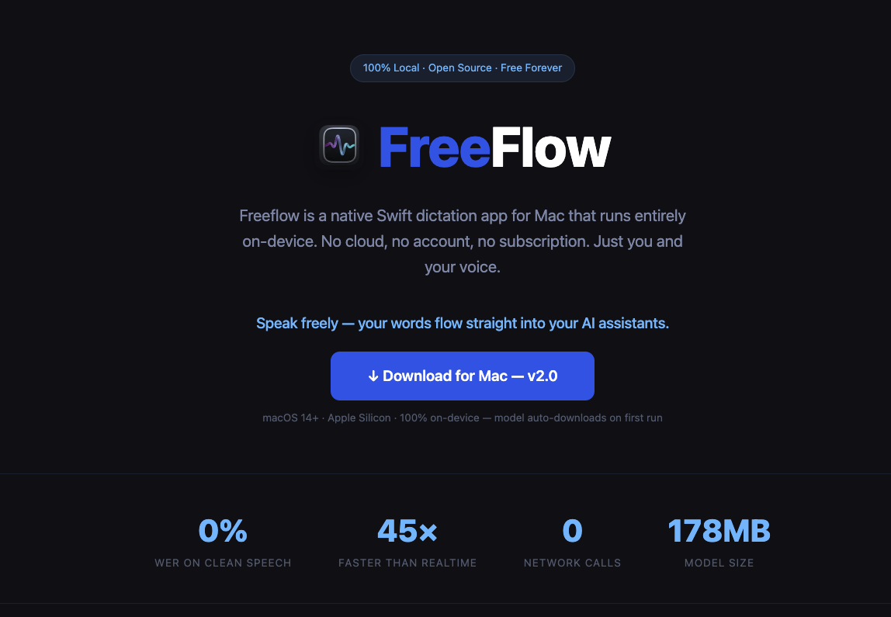
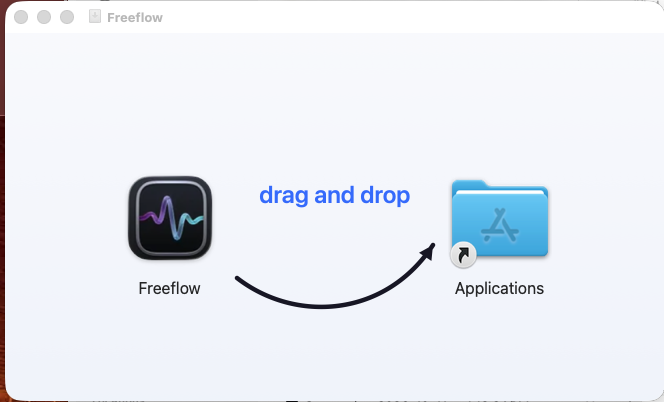
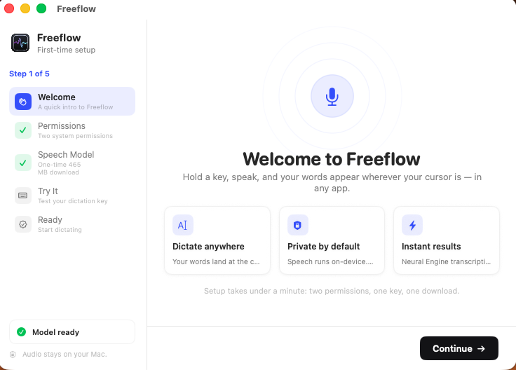
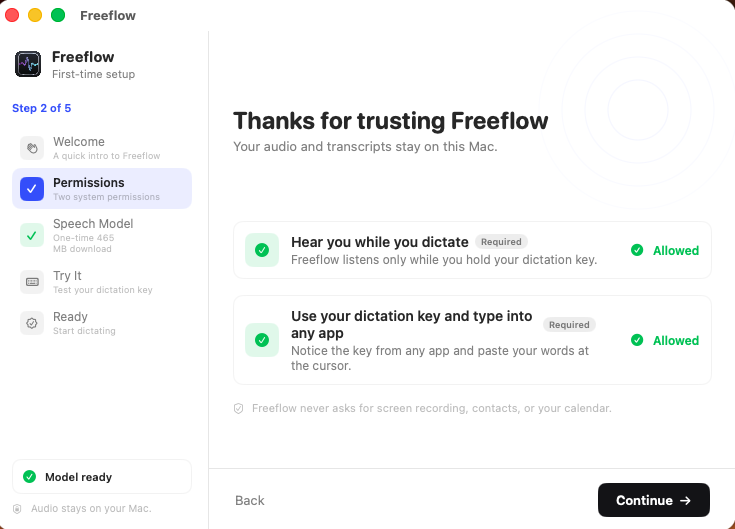
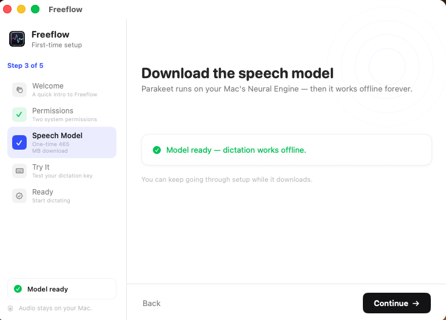
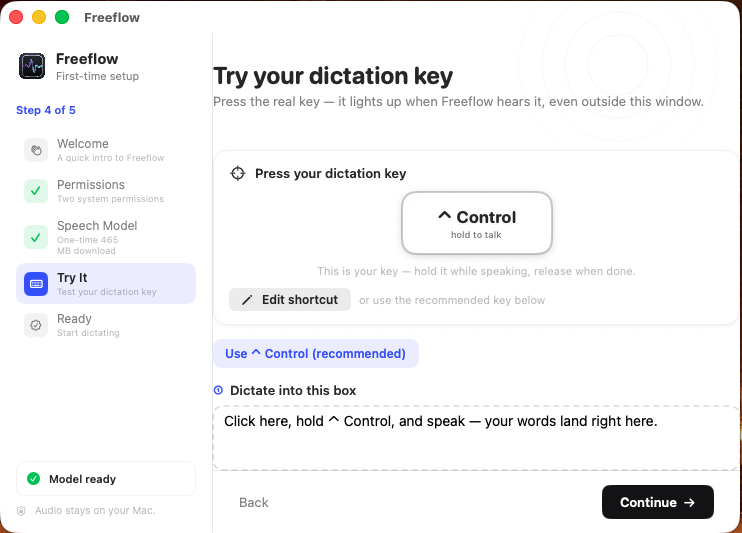

<p align="center">
  <a href="https://rohithperumandla.me/freeflow/">
    
  </a>
</p>

<h1 align="center">Freeflow</h1>

<p align="center">
  <strong>Hold a key. Speak. Your words appear — anywhere on your Mac.</strong><br>
  Free, open-source dictation powered entirely by on-device speech recognition.<br>
  No cloud. No account. No subscription.
</p>

<p align="center">
  <a href="https://github.com/Rohith1-p/freeflow/releases/latest">
    
  </a>
  <a href="https://github.com/Rohith1-p/freeflow/releases">
    
  </a>
  <a href="LICENSE">
    
  </a>
  
  
  
  
</p>

---

Freeflow turns your voice into text at your cursor, in any app. Hold your dictation key, speak naturally, release — and a locally-run speech model transcribes your words and pastes them exactly where you're typing. Docs, Slack, terminals, browsers, AI chat boxes — anywhere.

**Dictation** — Press-and-hold push-to-talk with any key (default: left ⌃ Control). A floating indicator shows live audio levels while you speak, then transcribes and pastes in a fraction of a second.

**Private by default** — Speech recognition runs on your Mac's Neural Engine. Audio never leaves your machine, nothing is uploaded, and no account is required. After the one-time model download, dictation works fully offline.

**Native and lightweight** — A ~10 MB Swift app with a menu bar presence, a five-step setup wizard, dictation history with stats, a hotkey recorder, and light/dark/system themes. Signed, notarized, and distributed as a drag-to-install DMG.

## How it works

| | |
|---|---|
| **1. Download & install** | Drag Freeflow to your Applications folder and open it. | 
| **2. Setup** | A one-minute wizard: two permissions, a key, and the model download. |
| **3. Hold & speak** | Hold your key and talk. Release — your words land at the cursor. |

<p align="center">
  
</p>

### Onboarding

<p align="center">
   
</p>
<p align="center">
   
</p>

### Demo

https://github.com/Rohith1-p/freeflow/raw/main/assets/demo.mp4

## Tech stack

| Layer | Choice |
|---|---|
| STT | Parakeet TDT (v3) via [FluidAudio](https://github.com/FluidInference/FluidAudio) — Core ML on the Apple Neural Engine, ~145× real-time |
| Language | Swift 6 · SwiftUI · AppKit |
| Hotkey | Listen-only `CGEventTap` (modifier-only keys supported) |
| Audio | `AVAudioEngine` 16 kHz mono capture with live level metering |
| Paste | Clipboard save/restore + `CGEvent` paste synthesis at the cursor |
| History | Local JSON store with per-app attribution and stats |
| Distribution | Developer ID signing · Hardened Runtime · notarized & stapled DMGs |

## Privacy

All speech recognition runs locally on the Neural Engine.

- **No cloud STT** — the model runs on-device; audio is never transmitted.
- **No accounts** — no sign-up, no keys, no telemetry.
- **Local history** — dictation history is stored on your Mac and can be disabled in Settings.

**What does use the network:** the one-time model download (~465 MB) from Hugging Face on first run. Nothing else.

## Build from source

```bash
git clone https://github.com/Rohith1-p/freeflow.git
cd freeflow
swift build -c release
```

Requires Xcode 16+ / Swift 6 toolchain, macOS 14+, Apple Silicon.

## License

MIT — free to use, modify, and ship. Parakeet model weights via FluidAudio (Apache-2.0).

---

<p align="center">
  <a href="https://rohithperumandla.me/freeflow/">rohithperumandla.me/freeflow</a> · <a href="https://github.com/Rohith1-p/freeflow/releases">Releases</a>
</p>
